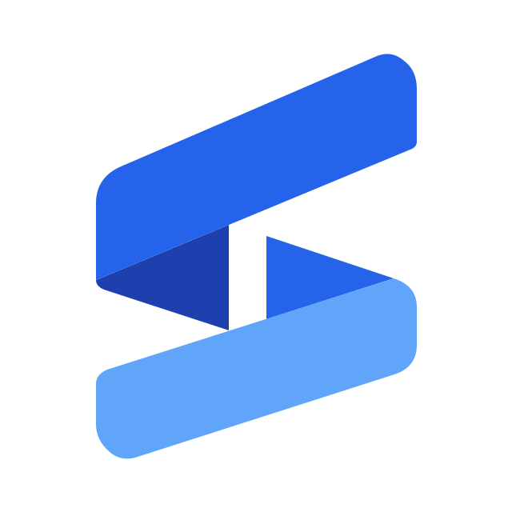

  
  <h1>KeyVia - AI满血中转站</h1>
  
一个入口，连接你的 AI 模型与开发工具。

  
GPT · Claude · Gemini

  

    <a href="https://keyvia.cc"><strong>访问官网 ↗</strong></a>
    &nbsp; · &nbsp;
    <a href="#quick-start">快速开始</a>
    &nbsp; · &nbsp;
    <a href="README.en.md">English</a>
  

---

KeyVia 为开发者和 AI 工具用户提供统一的 API 接入入口，支持 **OpenAI、Anthropic 和 Gemini 协议**，帮助你将模型接入日常编程、应用开发与智能工作流。

## 为什么选择 KeyVia

| 能力 | 为你带来的便利 |
| :--- | :--- |
| **多模型接入** | 在统一平台中接入 GPT、Claude、Gemini 等模型，按任务选择。 |
| **常用协议兼容** | 支持 OpenAI、Anthropic Messages 和 Gemini 接口，方便连接对应 SDK 与兼容客户端。 |
| **开发工具接入** | 提供 Claude Code、Codex、Gemini CLI、Cursor、Cline、Cherry Studio 等工具的配置指引。 |
| **便捷配置** | 从控制台获取 API Key 与接入配置，按工具要求设置 Base URL。 |
| **用量可查** | 集中管理密钥、查看用量与消费记录，跟踪 API 使用情况。 |

## 连接你熟悉的工具

**终端编程** &nbsp; Claude Code · Codex · Gemini CLI 
**编辑器与插件** &nbsp; Cursor · Cline 
**桌面客户端** &nbsp; Cherry Studio · Chatbox 
**应用开发** &nbsp; OpenAI SDK · Anthropic SDK · Google GenAI SDK

工具所需协议与模型支持取决于所选分组，请按官网对应接入指引配置。

## 三步开始

| 步骤 | 操作 |
| :--- | :--- |
| **01 · 创建账号** | 访问 **[keyvia.cc](https://keyvia.cc)**，注册或登录。 |
| **02 · 获取密钥** | 在控制台按需求选择分组并创建 API Key。 |
| **03 · 连接工具** | 按接入文档配置客户端或 SDK，发起第一次请求。 |

> **配置提示**：OpenAI、Anthropic 与 Gemini 的接口路径不同，请使用控制台为对应工具提供的配置。可用模型、协议、价格与额度以官网和所选分组的实时信息为准。

## 帮助与反馈

接入文档与服务信息请访问 **[KeyVia 官网](https://keyvia.cc)**。账号、订单或密钥相关问题，请登录控制台，通过「帮助与支持」联系客服。

---

  
<strong>让 AI 接入更简单</strong>

  
<a href="https://keyvia.cc"><strong>开始使用 KeyVia →</strong></a>

  本仓库用于服务介绍与官网导航

